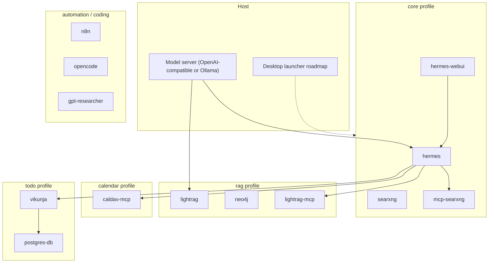

# Local Agent Stack

A Docker Compose stack that runs a **capable AI agent on your own machine**, private by default, with no cloud service needed for inference. It wires together chat, web search, knowledge graphs, workflow automation, and coding agents. A desktop launcher for non-technical users is on the roadmap.

## Quick start

```bash
./scripts/setup.sh          # secrets, data/, COMPOSE_PROFILES=core
make doctor                 # Docker, ports, model server from inside a container
# Start a host model server (OpenAI-compatible or Ollama) — or use --ollama
make up
# First Hermes boot only:
docker compose run --rm hermes setup && make up
```

Open **[http://localhost:8787](http://localhost:8787)** (Hermes WebUI). Dashboard: [http://localhost:9119](http://localhost:9119).

Zero-config demo (CPU Ollama in Docker):

```bash
./scripts/setup.sh --ollama
make up
docker compose run --rm ollama-pull
```

On Apple Silicon, Docker cannot reach the GPU. Prefer a **host** model server (LM Studio, host Ollama, llama.cpp, …) if you care about speed; the `ollama` profile exists as a self-contained demo path.

## Architecture



## Profiles

Each optional service has one switch in `.env`, its `*_ENABLED` flag. `make up`
(through `make ensure-local`) adds the service's profile to `COMPOSE_PROFILES`
when the flag is `1` and removes it when the flag is `0`, and Hermes registers
the service's tools from the same flag. `make services` lists every flag and
whether its profile is on.

| Profile | Flag | What you get |
|---|---|---|
| **`core`** (default) | | Hermes agent, Hermes WebUI, SearXNG, mcp-searxng |
| **`rag`** | `LIGHTRAG_MCP_ENABLED` | LightRAG + Neo4j knowledge graph + MCP sidecar |
| **`calendar`** | `CALDAV_MCP_ENABLED` | CalDAV calendars via caldav-mcp (multi-account) |
| **`automation`** | `AUTOMATION_ENABLED` | n8n + GPT Researcher |
| **`research`** | `GPTR_MCP_ENABLED` | GPT Researcher deep research as Hermes tools, without n8n ([docs/gpt-researcher.md](docs/gpt-researcher.md)) |
| **`coding`** | `OPENCODE_MCP_ENABLED` | OpenCode AI coding agent + Hermes coding delegation (opencode-mcp) |
| **`db`** | `SQL_MCP_ENABLED` | Shared Postgres for integrations and the agent + SQL MCP (read-only on the API profile) |
| **`todo`** | `VIKUNJA_MCP_ENABLED` | Vikunja todo lists (web app + built-in MCP), stored in the shared Postgres |
| **`mail`** | `MAIL_MCP_ENABLED` | Read-only search over Apple Mail, indexed on the host |
| **`mail-drafts`** | `MAIL_DRAFTS_ENABLED` | Hermes queues drafts for Mail's Drafts folder |
| **`messages`** | `MESSAGES_MCP_ENABLED` | Read-only iMessage/SMS history, indexed on the host |
| **`signal`** | `HERMES_SIGNAL_ENABLED` | signal-cli daemon for Hermes ([docs/signal.md](docs/signal.md)) |
| **`ollama`** | `OLLAMA_ENABLED` | Bundled Ollama + demo model pull |
| **`searxng-prod`** | `SEARXNG_PROD_ENABLED` | Valkey + rate limiting for SearXNG |
| **`search-gate`** | `SEARCH_GATE_ENABLED` | One SearXNG engine at a time ([docs/searxng.md](docs/searxng.md#search-gate)) |

`./scripts/setup.sh --rag --calendar` sets the flags and runs any first-time
setup a service needs (secrets, config files), so use it the first time you
turn a service on. After that, flip the flag and run `make up`.

The sync removes a profile only if it added that profile itself, which it
records in `COMPOSE_PROFILES_MANAGED`. A profile you wrote into
`COMPOSE_PROFILES` by hand while its flag is `0` keeps running, and `make up`
prints a warning until you set the flag or remove the profile. Profiles with no
flag, such as `core` or one from your own override file, are never changed.

## Security model (what the extra wiring buys you)

- **Localhost binds** for SearXNG, GPT Researcher, and the Hermes dashboard/API/WebUI. Nothing is LAN-exposed by default.
- **Hermes LightRAG MCP allowlist:** unattended API sessions get five read-oriented tools out of seventeen, and the bootstrap **drops unfiltered clone duplicates** so a `--clone`d profile cannot route around the allowlist.
- **Hermes CalDAV MCP allowlist:** unattended API sessions get read-only calendar tools; create/update/delete stay on dashboard and WebUI. Account credentials live in gitignored `compose/caldav-mcp/accounts/*.env` and are copied into Hermes MCP headers under `data/hermes/`.
- **Vikunja token scopes:** unattended API sessions get a read-only Vikunja token (11 list/read tools); the dashboard and WebUI get read/write. Vikunja enforces the scopes itself. The web app needs no password: a loopback-only proxy signs you in (`make todo-open`).
- **Per-profile API keys** for the Hermes `api-server` and `browser` gateways. Sharing one key fails closed.
- **OpenCode secret shadowing:** mount `compose/opencode/blank` over project `.env` files via gitignored `docker-compose.override.yml`.
- Setup writes secrets into **gitignored** overlays (`searxng/settings.local.yml`, Hermes `*.env`) and leaves tracked templates alone.

See [SECURITY.md](SECURITY.md).

## Prerequisites

- Docker Compose v2 (Linux, macOS, Windows/WSL2)
- A model server: any OpenAI-compatible API on the host (LM Studio, llama.cpp, vLLM, …), host Ollama, or the `ollama` profile

> **#1 gotcha:** inside a container, `localhost` is the container. Reach the host as `host.docker.internal`. The host server must listen beyond localhost (LM Studio: **Serve on Local Network**; Ollama: `OLLAMA_HOST=0.0.0.0`).

**Recommended:** 16 GB RAM when running a local 7–35B model beside the stack.

## Docs

| Doc | Topic |
|---|---|
| [docs/](docs/README.md) | Per-service guides |
| [Hermes](docs/hermes.md) | Agent gateway, skills, MCP |
| [Model defaults](docs/model-defaults.md) | Per-model sampling settings added by `llm-proxy` |
| [Calendar](docs/calendar.md) | CalDAV calendars via caldav-mcp (`calendar`) |
| [Shared database](docs/database.md) | Postgres schema-per-integration + SQL MCP (`db`) |
| [Todo lists](docs/todo.md) | Vikunja web app + MCP (`todo`) |
| [Hermes WebUI](docs/hermes-webui.md) | Chat UI + lean gateway mode |
| [Knowledge bases](docs/knowledge-bases.md) | Corpora, ingest, hot-workspace switching (`rag`) |
| [Projects](docs/projects.md) | Briefs, `sources.yaml`, INDEX, context roots |
| [n8n workflows](docs/n8n.md) | Workflows that call the stack (with `automation`) |
| [Writing voice](docs/writing-voice.md) | Drafting artifacts in your style (not chat tone) |
| [Memory](docs/memory.md) | Built-in USER.md, session search, curated notes |
| [Independent agents](docs/agents.md) | Multi-role Hermes profiles, shared vs private memory |
| [User data directory](docs/data-dir.md) | Relocate projects / voice / memory / LightRAG inputs |
| [Releasing](docs/releasing.md) | Thematic commit playbook for the first public history |

## Commands

```bash
make setup / ./scripts/setup.sh
make doctor
make model-use MODEL=…          # or FROM_LMSTUDIO=1 (interactive menu), YES=1, PRESET=…
make model-sync                 # re-apply LLM_MODEL from .env to Hermes and OpenCode
make model-defaults-add EXAMPLE=…  # per-model sampling settings (docs/model-defaults.md)
make up / make down / make ps
make logs
make data-dir-show / data-dir-set DIR=… / data-dir-migrate DIR=…
make hermes-reload             # re-apply Hermes config (both bootstraps + recreate hermes)
make hermes-upgrade AGENT=v… WEBUI=…
make clean   # destroys volumes + repo ./data/ (not an external ASSISTANT_DATA_ROOT)
```

## Roadmap

- Desktop app that launches and manages this Docker setup for non-technical users
- Harden first-run UX (`make doctor` coverage, guided model install)

## License

MIT — see [LICENSE](LICENSE).

The MIT license covers this repository's own files. The services it starts are
upstream images pulled at run time under their own licenses; none is copied
into or redistributed with this repo. For example, the optional `todo` profile
runs [Vikunja](https://github.com/go-vikunja/vikunja), which is AGPL-3.0, from
the unmodified `vikunja/vikunja` image. The stack talks to it only over its
HTTP API and does not patch it. See [docs/todo.md](docs/todo.md#license).
