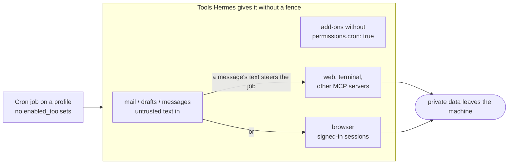
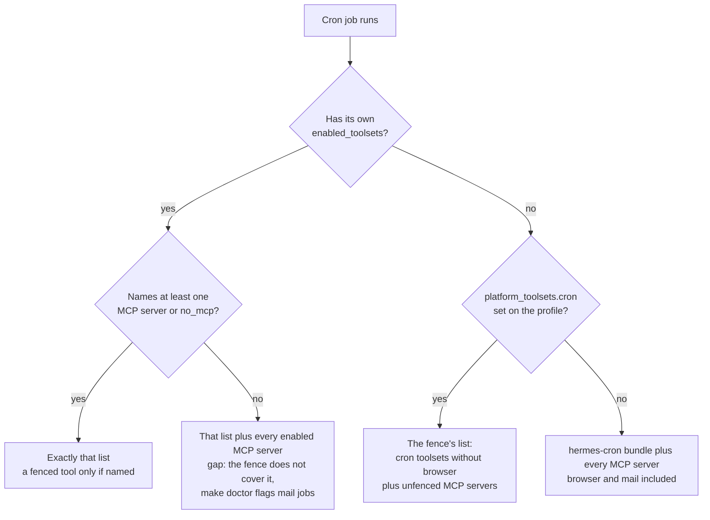
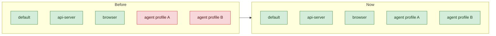
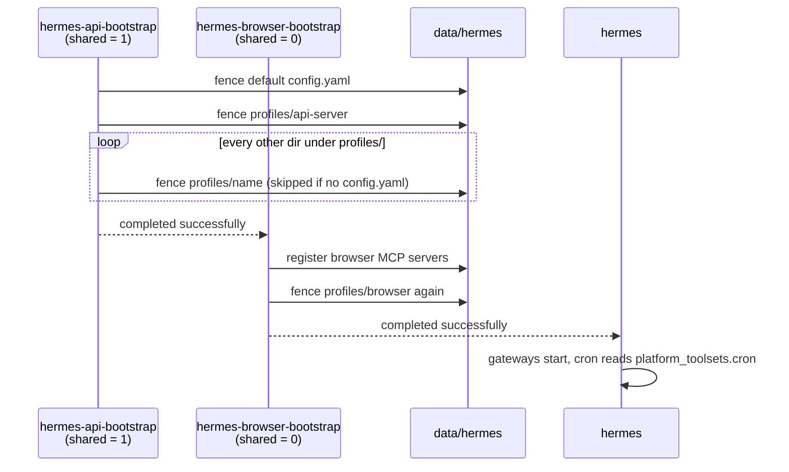
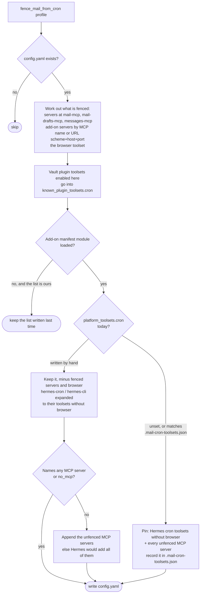

# Cron fence

The bootstraps' cron fence (`fence_mail_from_cron` in
`compose/hermes/bootstrap-api-profile.sh`) keeps mail, messages, the browser
and add-ons without `permissions.cron: true` away from Hermes cron jobs that
don't ask for them. The rules are in
[contracts/agent.md](contracts/agent.md#scheduler); the tests are
`scripts/test-addon-cron-fence.sh`.

## Why cron needs a fence

A cron job runs with nobody watching. If it has no `enabled_toolsets` of its own,
or has a list that names no MCP server, Hermes gives it every enabled MCP server
on its profile, alongside web search, the browser and a shell. Text the job reads
from mail or messages could then steer it into sending that data somewhere else.

## Which list a cron job's tools come from

## Agent profiles

Until the change below, the fence ran on the default profile and on each
bootstrap's own profile. Profiles made with `make agent-create` had no
`platform_toolsets.cron`, so their jobs fell into the "everything" box above.

Green: fenced. Red: cron jobs keep mail, messages, fenced add-ons and the browser.

## When the fence runs

`fence_mail_from_cron_all_profiles` uses the same loop over profiles as
`apply_model_proxy_all_profiles`. hermes-api-bootstrap runs the shared steps
(`HERMES_BOOTSTRAP_SHARED=1`). hermes-browser-bootstrap runs after it with
the shared steps off and does only its own profile, after registering its own
MCP servers. A bootstrap whose stamp matches the last run skips the fence entirely.

Each fenced profile costs about 1.6 s (one Python process that loads Hermes'
toolset code).

## What the fence does to one profile

`fence_mail_from_cron <profile>` reads that profile's `config.yaml`.

A job that needs a fenced tool, like `make mail-triage-cron`, names it in its own
`enabled_toolsets` and gets it.
